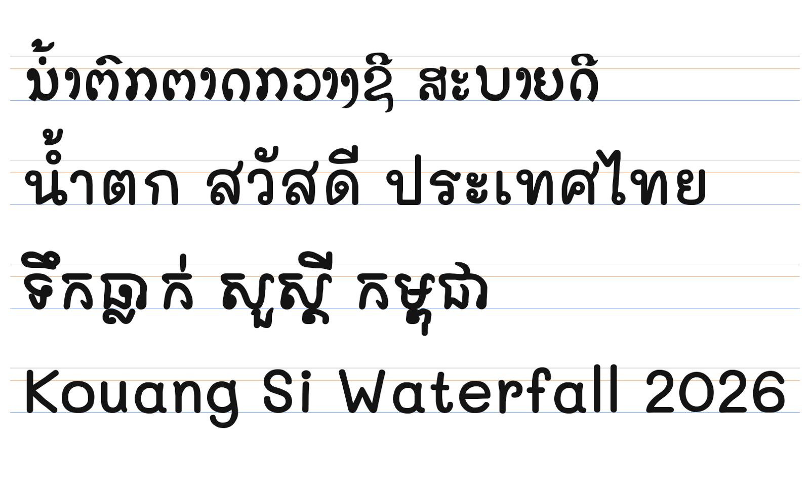
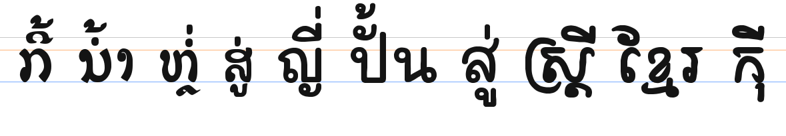

# Kouang Si Waterfall ນ້ຳຕົກຕາດກວາງຊີ
_A Hand Painted Lao Signage Font, now with Thai, Khmer and Latin_

**[Try it online](https://rcampbellbassac.github.io/KouangSiWaterfall/)** · **[Download version 0.200 (beta)](https://github.com/rcampbellbassac/KouangSiWaterfall/releases/latest/download/KouangSiWaterfall.zip)** · SIL Open Font License 1.1

## What's new in 0.200 (beta)

- **Thai, Khmer and Latin now match the Lao.** They are rebuilt on hand-lettered skeletons instead of Noto:
  Thai, Latin, digits and punctuation on [Mali](https://github.com/cadsondemak/Mali), Khmer on
  [Fasthand](https://github.com/danhhong/Fasthand) (both SIL OFL). Each gets the round brush and size measured from
  the Lao (stems about 107 units on a 600-unit body), and Fasthand's slant is removed so Khmer stands upright like the Lao.
- **Khmer shifters.** ៉ and ៊ before an above vowel now drop below the consonant, so they never collide.
- Rare characters the skeletons lack (extended Latin, Khmer lunar-date signs, math and symbols) still come from Noto.

## In 0.100 (beta)

- **Thai, Khmer and Latin.** New letters drawn with a soft brush matched to the original Lao stroke
  (`scripts/recipe.json`) on the thin Noto designs, so one font now covers Lao, Thai, Khmer and English.
  The original hand-drawn Lao letters are unchanged.
- **More Lao.** The Pali and Sanskrit letters, ໞ ໟ and U+0ECE were missing; they are now included
  (generated to match, ready to be redrawn by hand).
- **Modern font metrics.** The old vertical metrics (ascender 1450, x-height 1054 on a 1000-unit em) made
  line spacing huge and inconsistent between apps. Typo, hhea and Windows metrics now agree, leave room for
  stacked vowels and tone marks, and `USE_TYPO_METRICS` is set.
- **Correct OpenType data.** `lao`, `thai` and `khmr` script tags, mark positioning for every script,
  Unicode and code page ranges, installable embedding, complete name records.
- **Web and desktop files.** `fonts/` has TTF, WOFF2 and WOFF. The demo page lives in `docs/`.
- **QA.** Every case in a Lao/Thai/Khmer shaping corpus renders with no missing glyphs (`qa/`).

Rebuild with `python scripts/build_multiscript.py` (Python 3.11+, `pip install fonttools pyclipper booleanOperations uharfbuzz pillow`).
The Lao source of truth is still the FontLab/UFO/Glyphs sources in `KouangSiWaterfall/`.

---

## The original story

Kouang Si Waterfall - an Open Source and Open Licensed Display Font - SIL OFL v1.1 License

# Check It Out
You can view an example of this font with your web browser (works best on Chrome/Safari).
[HTML Preview Service](https://htmlpreview.github.io/?https://github.com/rober42539/KouangSiWaterfall/blob/master/example.html)

# Coverage
This font only currently includes Lao. It doesn't have Latin numbers, symbols, and various other useful things. I plan to get around to them. Hey, why not beat me to it, make your own, and send a pull request?

# Use the Font
You can download and install the TTF on your computer, and use it freely:
[Latest Kouang Si Waterfall TTF Font](https://github.com/rober42539/KouangSiWaterfall/raw/master/KouangSiWaterfall/OpenType-TT/KouangSiWaterfall-Regular.ttf)

# Purpose
Lao doesn't have a lot of display font options. There are a few decent fonts for general text that are open source/open licesned (SIL OFL). There are some old fonts that aren't very modern, but do the job (some are better than others). But, there aren't many Lao display fonts, especially those designed to make headers and larger text more appealing for young people, which are open. This font is a meager attempt to change that.

# Inspiration
There's a sign for a waterfall in Luang Prabang, called Kouang Si Waterfall. Here is an example of the sign:
[The Sign that Started It All](https://www.flickr.com/photos/80050386@N07/35219072733/in/photolist-VEbXiX-4Z7ko3-2eZuDbi-7FWxa-8cuddi-8h8MXe-9yQvei-QLg4nN-mPBT8x-dNED6-7xuTLH-HnMKBz-GLz8FA-fP8BQH-5UwHVm-uUyA6z-R9fXij-ZVSsK4-ECJ2co-242FUya-5gxgMG-88fwUY-DusSLS-DusSsW-oT2iFT-23gU7Ys-aby9Mc-NXhQTZ-8qbUW7-abTdr4-aqQRRd-cM2Y1o-6o2NFb-K471b6-RLYi32-6tqKRf-69W5tA-85N2gJ-GGcVA-nkf2NM-dYArTQ-RNqi9-2eidi5w-PgWuDN-22b5nYv-pNLGWA-amS2mD-CPxJue-QNP9VK-ZgoF4C)

It forms the basis for my first basic Lao font. It adds just a little bit of extra character (pun intended) to headings and larger text, moving away from that classical doctoral thesis feel into something more fun. :smile:

# History
This is my first attempt to create a font. I love open source, and I thought this might be a good way to contribute and help the Lao people. It started as a need for a better font for headers in kid-friendly materials. But why make something for myself and not share it with others?

# Work in Progress
It's certainly not the prettiest. Certainly not the most demanding. It won't fold your laundry, or cook your food. If it makes a kid enjoy reading a little more, then it has served its purpose! But that doesn't mean it needs to stay stagnant. If you want to improve upon it, feel free to contribute, modify it, or use it as a template to create something great! I'm using FontLab 7, but I've included some other formats if you want to tinker in something else. If you have another preffered format, put a request up in the issues.

# Contriubutors
_Your name could be here!_

A big shout out to those who helped provide me with some guidance, get me started, and put up with my newbieness:

Dave Crossland (Google), Ben Mitchell (Fontpad), Dr John Durdin (LaoScript), Marc Durdin (Keyman),Sovichet Tep (Romnea Type), Fadhl Haqq (Alterna Type), Aditya Bayu Perdana, everyone else at the SEA Font Workshop 2019, Sengkeo Vangxiengvue (Saonatype), Andy McConnell, Victor Gaultney (SIL), and more...

To each of you, **thank you**!

_Journeys are always better together!_ :smile:
